## 作者 / Author

Linux.do：[cturing](https://linux.do/u/cturing/summary)

# MemDock

**Claude Code 和 Codex 的对话可以双向互转，换工具也能接着做。** MemDock 是 macOS 和 Windows 上的桌面工作台，把项目会话、图形聊天、原生命令行、分屏终端、代码和 Skill 放在同一个界面。

> MemDock is a source-available desktop workspace for Claude Code and Codex on macOS and Windows, with two-way session conversion, graphical chat, native CLI, split terminals, and project tools.

[下载安装包](https://github.com/LingyiChen-AI/MemDock/releases/latest) · [会话互转](#会话互转) · [聊天命令行与分屏终端](#聊天命令行与分屏终端) · [Worktree 并行开发](#用-git-worktree-并行开发) · [功能一览](#功能一览)

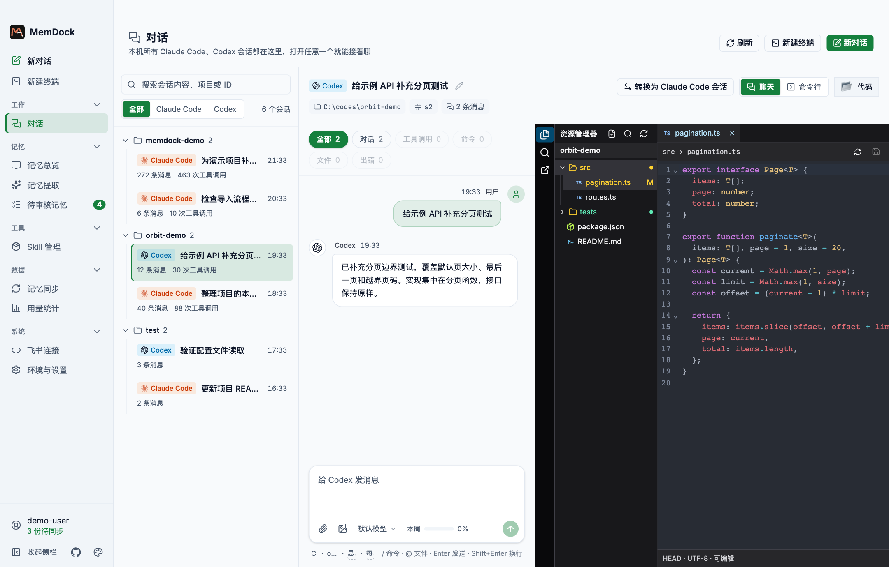

*截图来自 MemDock 的真实界面，使用示例项目、账号、路径和会话内容。*

## 为什么做 MemDock

我经常用 Claude Code 和 Codex 做同一个项目。一个工具分析完问题，想换另一个实现，却要翻聊天记录，重新交代改过哪些文件、试过哪些方案。日常还要在两套命令行、编辑器和配置目录之间切换。Skill 装在不同位置，来源和更新得自己查。换一台电脑，项目规则、常用 Skill 和偏好又得重新找一遍。

我做 MemDock，是想让这些操作都能从项目出发。打开项目就能找到之前的对话，选择用哪个助手接手，边聊边看改动。想用原生 CLI 时可以切到命令行。换设备时，也能从自己的 GitHub 私有仓库恢复记忆和偏好，再按清单补装 Skill。

## 会话互转

例如，你已经用 Claude Code 梳理完一个接口的改动方案，接下来想让 Codex 写测试。打开这条会话，点击 **转换为 Codex 会话**，MemDock 会在目标工具中生成一条可继续的会话，并给出恢复命令。也可以反过来，把 Codex 做到一半的任务交给 Claude Code。对话正文会带过去，能映射的命令会按目标工具的格式转换。

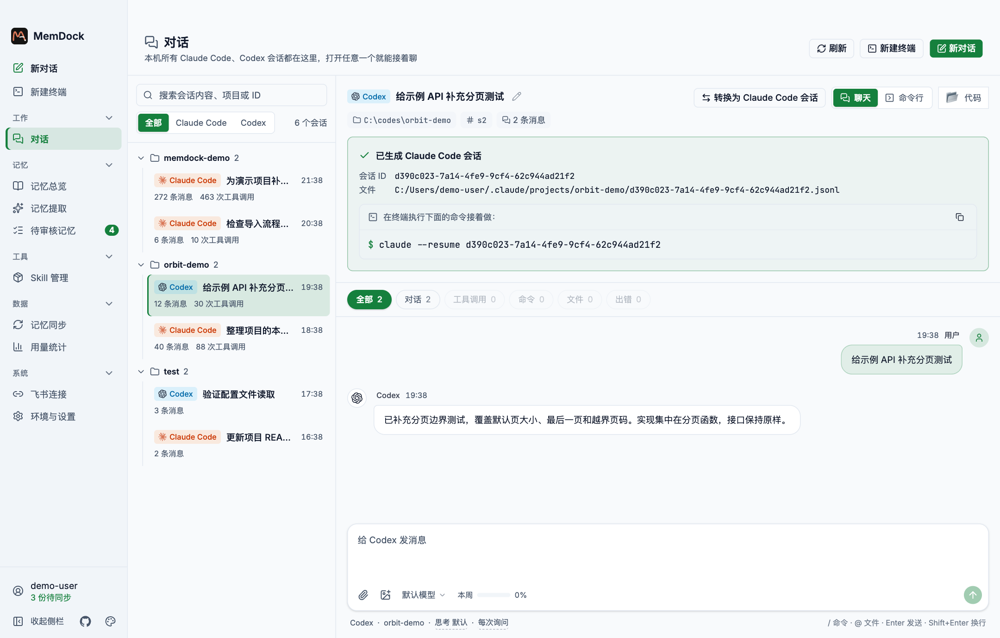

## 聊天、命令行与分屏终端

- **聊天视图**适合浏览长对话和继续交互。按项目找回两边的会话，查看 Markdown、图片和工具调用，选模型和权限，查看上下文用量，并在同一页打开代码分栏。
- **命令行视图**在内置终端里打开 Claude Code 或 Codex 的原生交互界面。用熟悉的 CLI 命令继续当前会话，需要时再切回聊天。
- **独立终端**可直接在项目目录打开 Shell，横向或纵向分屏。在一栏运行助手，另一栏跑测试、看 Git 状态或执行构建，也能在新分屏启动另一个助手。

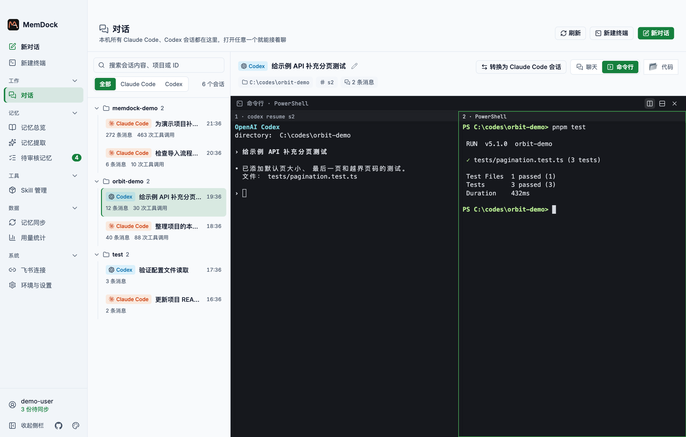

## 用 Git Worktree 并行开发

同一个 Git 项目可以同时开几条开发线。例如，让 Claude Code 在一个工作区补分页测试，同时让 Codex 在另一个工作区更新接口文档。每个会话各用一个目录和分支，两个助手可以独立运行、修改文件和测试。

1. 在项目旁点「＋」，选「在独立工作区新建会话」。
2. 为每条任务分别建工作区，在各自的对话或终端里开发。
3. 做完后在「独立工作区」查看文件差异，选择压缩成一个提交合并、保留全部提交合并，或只保留分支。可以在合并后清理工作区。

## 功能一览

### 代码分栏

在对话旁浏览项目文件树，按文件名或内容搜索，打开多个标签页编辑、预览 Markdown、查看 Git 改动，也可以从项目打开 VS Code。

### Skill 管理

Claude Code 和 Codex 的全局、项目级 Skill 集中在一个入口。可以检查来源和文件内容，从 GitHub 仓库、本地目录或 ZIP 安装，检查更新，在两个工具之间复制，或从备份恢复。Skill 清单支持导入和导出，也可以随记忆一起同步。Superpowers 这样的插件包按整包记录，换设备后可从对应工具的市场恢复。第三方市场需要先在新设备上配置。

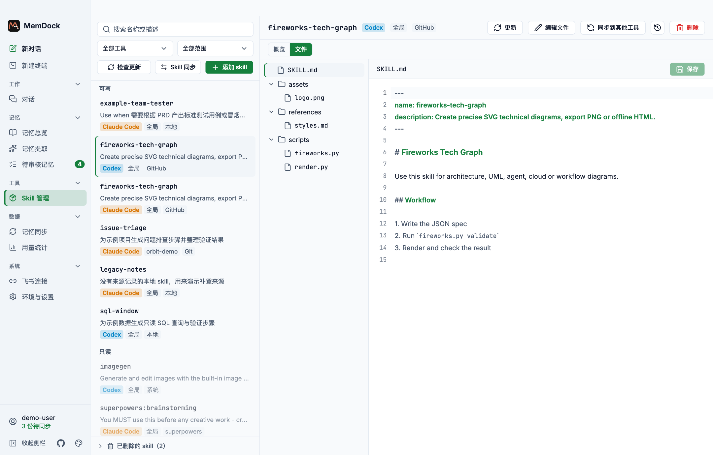

### 管理记忆与项目规则

在「记忆总览」里按全局或项目查找 `CLAUDE.md`、`CLAUDE.local.md`、`AGENTS.md` 和 Claude 自动记忆，也能浏览只读的 Codex 记忆库。打开文件就能编辑、分栏预览或查看版本历史，改错了可以回滚。需要理解一条规则和哪些项目决策有关时，还可以打开项目记忆图谱，从关系节点跳回来源文件。

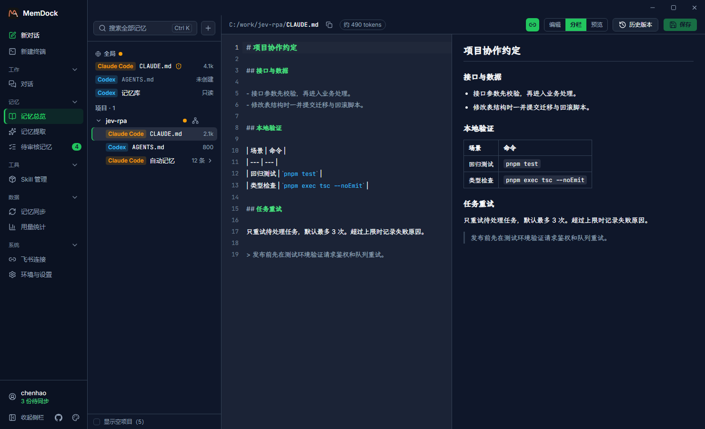

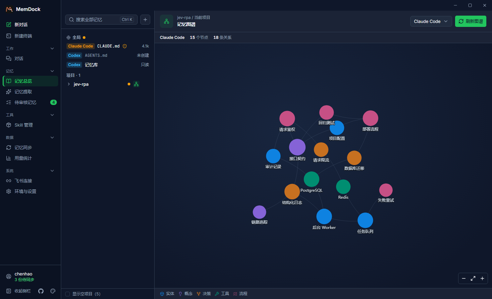

### 让记忆跟上项目变化

测试命令、部署流程和团队约定都会变。比如数据库从库延迟已从 2 秒改为 1 秒，如果项目记忆还写着 2 秒，下次开新会话时，助手仍可能沿用旧值。把已确认的变更写回项目规则，可以减少重复纠正，也让换设备后的助手读到同一份约定。

在「记忆提取」中选择项目和回看范围，点「立即运行」，也可以设置每天或每周提取。MemDock 会从近期对话里找出值得保留的新经验和需要修订的旧规则，生成建议。

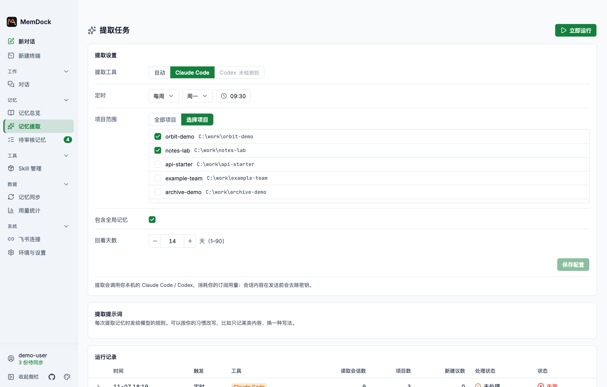

到「待审核记忆」查看建议的变更和原对话依据，再决定采纳、编辑后采纳或驳回，也可以批量处理。采纳后，改动才写入记忆文件。从 GitHub 仓库导入的记忆也会先进入审核列表。

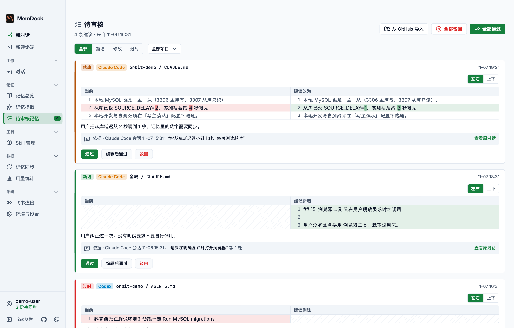

### 在新机器恢复记忆

1. **在旧机器上传。** 在「记忆同步」登录 GitHub，确认要同步的项目，点「上传到云端」，把记忆写入自己的 GitHub 私有同步仓库。
2. **在新机器拉取。** 使用同一个 GitHub 账号和同步仓库，打开或添加对应的本地项目。看到「检测到云端已有记忆」后，点「一键同步到本机」，也可以用「同步到本地」。这一步只从云端拉取。

   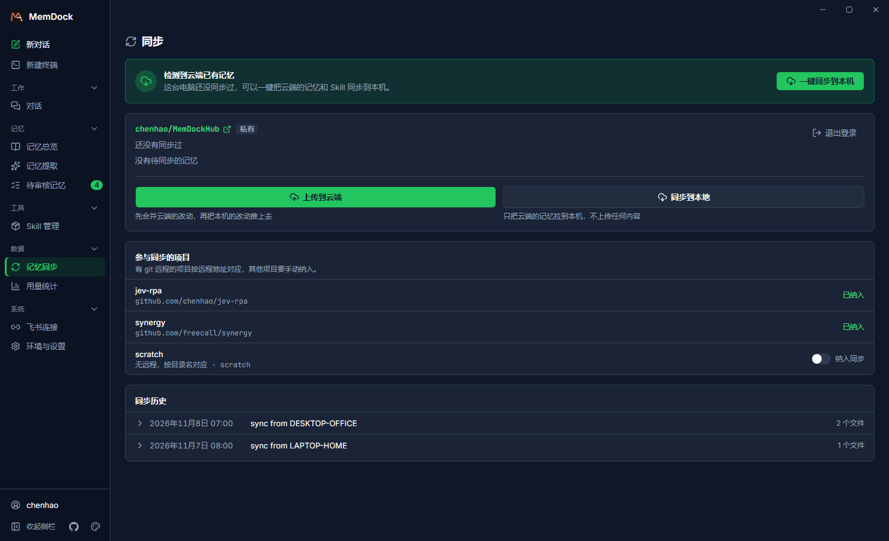

3. **查看写入结果。** 有冲突时可以逐块选择保留内容。如果提示找不到对应项目，先打开或添加项目再同步一次。若缺少 Claude Code 的项目记忆目录，先在对应项目里运行一次 Claude Code。

   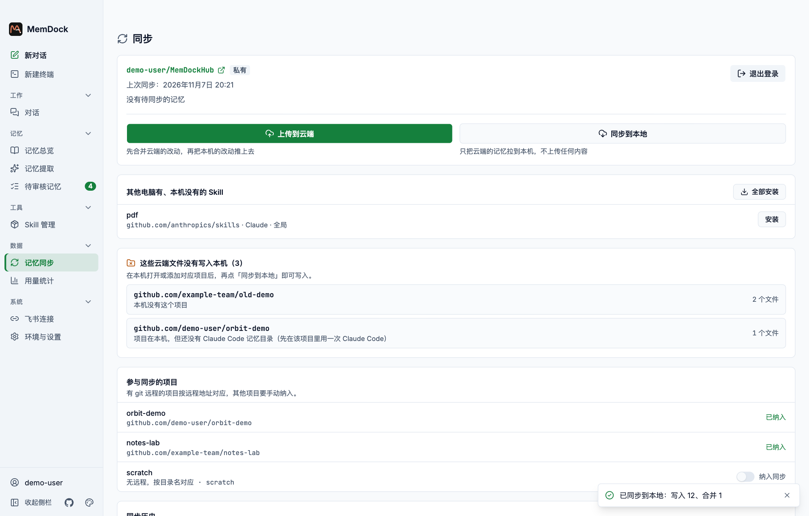

同步后可以按清单补装缺失的 Skill。偏好可在「设置 → 偏好同步」单独从云端获取。上传时遇到疑似密钥的文件，MemDock 会提示核对，跳过记录可以回看。

### 用量与额度

从本机日志统计两种工具的 Token 用量和估算费用，按时间、模型查看趋势和活跃热力图，也可以导出 CSV。登录状态和凭据可用时，可以选择开启实时额度查询，查看短周期和周额度。

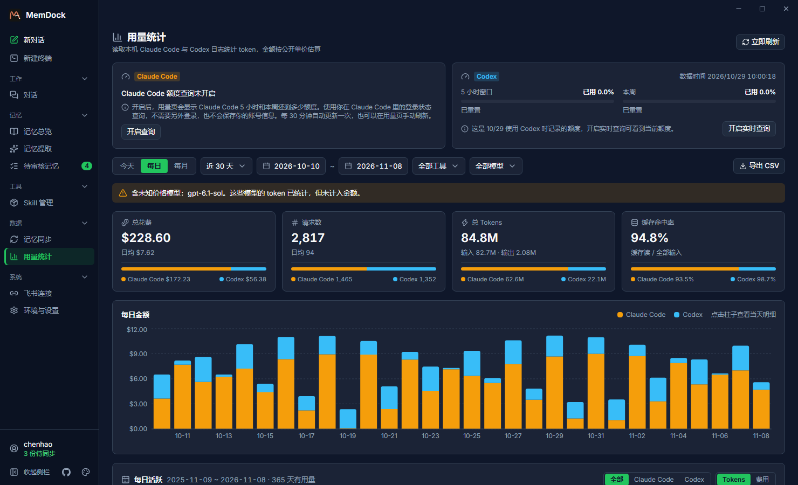

### 飞书连接

通过飞书企业自建应用连接本机 Claude Code 或 Codex。可以配置多个机器人，在飞书管理应用可用范围和群聊成员，并在 MemDock 为每个绑定项目单独设置读取、新建、修改和删除权限。新绑定默认只读。私聊可直接发送消息，群聊里 @ 机器人即可在群内收到回复。

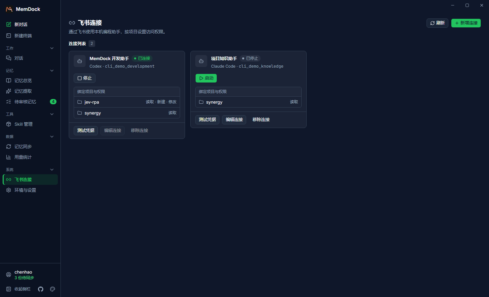

### 环境与桌面设置

检测 Claude Code、Codex、Node.js、npm 和 Git，支持从界面安装编程助手 CLI。提供中英文界面、跟随系统或手动选择深浅主题、强调色和托盘。安装版会在启动后及运行期间定时检查更新，也可以在「环境与设置 → 应用更新」手动检查并安装。

## 安装与开始使用

1. 在 [GitHub Releases](https://github.com/LingyiChen-AI/MemDock/releases/latest) 下载对应系统和架构的安装包。
2. 打开「环境与设置」，确认要用的 Claude Code 或 Codex CLI 已安装，并在对应工具中登录。
3. 打开「对话」，选择已有项目和会话，或从工作目录新建对话。需要跨设备迁移时，再到「记忆同步」登录 GitHub。

## 开发与发布

需要 Node.js 24.15+（24 LTS）、pnpm、Rust（stable）和 Git。

```bash
pnpm install
pnpm tauri dev        # 启动开发版
pnpm test             # 前端测试（Vitest）
cargo test --manifest-path src-tauri/Cargo.toml   # 后端测试
pnpm tauri build      # 打包
```

### 发布与更新

- `main` 的 CI 运行测试并构建 macOS 和 Windows 安装包。安装包可从该次 Actions 运行的 Artifacts 下载。
- 正式发布时同步更新 `package.json`、`src-tauri/Cargo.toml`、`src-tauri/Cargo.lock` 和 `src-tauri/tauri.conf.json` 的应用版本，再从已通过 CI 的 `main` 提交推送同版本的 `vX.Y.Z` 标签。Desktop Release 会打包 macOS（Apple Silicon / Intel）及 Windows（x64），确认更新清单包含三个平台的签名后发布 GitHub Release。
- 打 tag 前，在 `docs/releases/vX.Y.Z.md` 写好「更新与改进」和「问题修复」，按用户能看到的变化来写。GitHub 会附上已合并的 PR（如有）和完整变更链接，客户端只显示手写的更新说明。
- 首次发布、升级 Rust 工具链或较大范围调整 Rust 依赖后，可在 Actions 的 Desktop Release 中选择 `main` 并运行一次工作流，提前编译三种平台并保存缓存。等预热结束再推 tag，正式发布会尝试复用缓存。
- 发布工作流使用 Actions Secrets 中的 `TAURI_SIGNING_PRIVATE_KEY` 和 `TAURI_SIGNING_PRIVATE_KEY_PASSWORD`。请长期保存这对签名凭据。客户端使用配置中的公钥验签，下载 GitHub Release 不需要登录。GitHub 同步的设备登录使用公开的 OAuth Client ID，可在自行打包时通过 `MEMDOCK_GITHUB_CLIENT_ID` 覆盖。
- 安装版客户端启动后及运行期间每 30 分钟检查一次更新。也可在「环境与设置 → 应用更新」手动检查并安装。已有版本首次接入时需要手动安装支持更新的版本。

目录结构：

```
src/                 前端（React + TS + Tailwind v4 + shadcn/Radix）
  pages/             各功能页面
  components/        通用组件（ui/、chat/ 等）
  i18n/              中英文文案
src-tauri/src/       后端（Rust）
  memory/ extract/   记忆索引、提取与审核
  skills/            Skill 管理
  convert/           会话解析与互转
  sync/              GitHub 同步引擎
  usage/             用量统计
```

## 数据和隐私

- 记忆、会话和用量以本机文件为来源。记忆提取和关系图谱调用你已登录的编程助手 CLI，因此相关内容会按该工具的配置交给模型处理。记忆提取会在调用前清理疑似密钥。
- GitHub 同步将你选定的内容上传到自己的私有仓库。GitHub 登录令牌和飞书 App Secret 保存于系统凭据库。
- 实时额度查询默认关闭。飞书、GitHub 同步和应用更新会连接各自的服务。

## 许可协议 / License

本项目采用 [MIT 许可证](LICENSE)。允许使用、修改和分发，包括商业用途。分发软件的副本或主要部分时，请保留版权声明和许可声明。

Licensed under the [MIT License](LICENSE).
